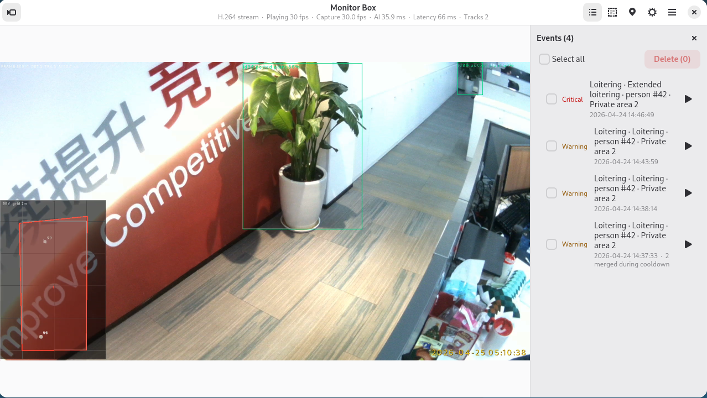

# 📹 Monitor Box - AI Video Surveillance

[简体中文](README.zh-CN.md) | English

Monitor Box is an AI video-surveillance demo built for the **[Quectel Pi M2](https://developer.quectel.com/)** single-board computer (Rockchip **RK3576**, Debian 13). It captures a USB UVC camera stream, runs object, pose and fire/smoke models on the 6 TOPS NPU, and converts the results into configurable surveillance alarms.

The implementation includes a C++17 capture and inference backend plus a Python + GTK4/Libadwaita desktop app. The same backend also provides a browser console, MJPEG preview, H.264 stream, snapshots, alarm clips and a local HTTP API.



Core features:

- Real-time person, vehicle, pet and other COCO object detection
- Intrusion, electronic fence, loitering and abandoned-package alarms
- Directional people counting through configurable crossing lines
- Pose-based fall detection
- Fire and smoke detection with temporal confirmation
- Ground-plane positioning, tracks, ground zones and a bird's-eye view
- Desktop and web interfaces backed by one persistent configuration
- Event snapshots, pre/post alarm clips, audio prompts and low-power modes

> **Status:** the RK3576 camera → detect → track → rules → OSD → event/streaming pipeline is implemented. RKNN runtime **2.3.2** is required. The default YOLOv8s detector takes about **29.6 ms/frame** on the NPU; optional pose and fire/smoke models are supported. Validate camera placement and alarm thresholds at the installation site.

## 🎯 Key Features

- **NPU-accelerated detection**: YOLOv8s INT8 by default, with YOLOv8n available as a lower-power alternative.
- **Shared tracking and rules**: all spatial features use one tracker; a disabled feature is not instantiated and does not consume CPU.
- **Flexible alarm regions**: draw multi-point private, public, ignore and calibration regions directly on the live view.
- **People counting**: use directed crossing lines with separate `IN` / `OUT` totals and a rolling JSONL history.
- **Fall detection**: run RTMPose-t only on detected person regions, with pose cadence and verdict thresholds exposed in the configuration.
- **Fire and smoke inference**: run a separate D-Fire model and suppress single-frame false positives through temporal voting.
- **2D visual positioning**: calibrate the ground plane, convert foot points to metres, smooth tracks and display a bird's-eye view.
- **Complete event pipeline**: debounce, cooldown, severity routing, snapshots, pre/post clips, retention and optional sirens.
- **Desktop and remote operation**: use the GTK4 app locally or the built-in web console from a browser on the same network.

## 🖥️ Interface Overview

The desktop app is organized around one live video view and three frequently used tools:

1. **Live view** – backend video, detection boxes, active regions, counting lines and performance metrics.
2. **Events** – alarm history with severity, snapshots, clips and delete actions.
3. **Regions** – draw and edit alarm zones, crossing lines, ignore areas and ground calibration.
4. **Settings** – detection switches, event audio, video/inference settings, positioning and power mode.

The built-in web console provides the same configuration and event data through `http://<board-ip>:8080`. Both interfaces share `config/monitor_box.json`; changes saved through one interface are visible to the other.

## ⚙️ Working Principle

1. **Capture** – V4L2 reads a UVC stream, normally 1920×1080 MJPG at 30 fps.
2. **Preprocess** – frames are decoded, letterboxed and prepared for the configured NPU model.
3. **Infer** – RKNN runs object detection, person pose and/or fire/smoke inference on separate schedules.
4. **Track and analyze** – ByteTrack-style tracking stabilizes target IDs; spatial rules evaluate zones, lines, dwell time and ground coordinates.
5. **Output** – the backend draws OSD overlays and publishes MJPEG, H.264/RTP, event snapshots and alarm clips.

```text
USB UVC camera
      │
      ▼
V4L2 capture ──► preprocess ──► RKNN detection / pose / fire
      │                                  │
      │                                  ▼
      └────────────► tracker ──► rules and event engine
                                         │
              ┌──────────────────────────┼──────────────────────────┐
              ▼                          ▼                          ▼
       OSD + MJPEG/H.264          snapshots + alarm clips       APP / Web UI
```

## 📋 System Requirements

### Hardware

- Quectel Pi M2 single-board computer (RK3576)
- USB UVC camera; 1080p MJPG is recommended
- Network connection for the web console
- Display, keyboard and mouse for the local desktop app (optional)
- Speaker or USB audio device for alarm prompts (optional)

### Software

- Debian 13, the default Quectel Pi M2 image
- RKNN runtime `librknnrt.so` **2.3.2**
- SDK cross-toolchain, or `g++` on the board for a native build
- Python 3 with GTK4, Libadwaita and GStreamer for the desktop app
- `librknnrt`, RGA, MPP and JPEG runtime libraries on the board

The RKNN header, board runtime and model-conversion toolkit must all use **2.3.2**. A version mismatch usually makes `rknn_init` fail while loading the model.

| Component | Required version |
| --- | --- |
| Board `librknnrt.so` | 2.3.2 |
| `rknn_api.h` used at build time | 2.3.2 |
| `rknn-toolkit2` used for conversion | 2.3.2 |

> The MIPI OV5693 route is not supported by this project. The shipped kernel does not enable the required sensor driver and the board lacks the matching device-tree node and IQ calibration file.

## 🚀 Build, Deployment and Run

### 1. Build from the SDK

Run the following on the SDK host:

```bash
git clone https://github.com/Quectel-Pi/QPi-SDK.git
cd QPi-SDK
git clone https://github.com/Quectel-Pi/demo-monitor-box.git projects/demo-monitor-box
make -C projects/demo-monitor-box
```

The main outputs are:

```text
projects/demo-monitor-box/build/mb-infer
projects/demo-monitor-box/build/mb-capture
```

`mb-capture` is the live surveillance backend. `mb-infer` is an offline single-image tool for checking the model and NPU path.

To run the host-side regression tests:

```bash
make -C projects/demo-monitor-box test
```

### 2. Deploy to the board

Connect the board through ADB and verify that the shell has root access:

```bash
adb devices
adb shell id
```

From the SDK root, transfer the runtime files:

```bash
adb shell 'mkdir -p /userdata/monitor_box/deploy/build /userdata/monitor_box/deploy/config /userdata/monitor_box/deploy/models /userdata/monitor_box/deploy/tools /userdata/monitor_box/deploy/app'

adb push projects/demo-monitor-box/build/mb-infer projects/demo-monitor-box/build/mb-capture /userdata/monitor_box/deploy/build/
adb push projects/demo-monitor-box/config/monitor_box.json /userdata/monitor_box/deploy/config/
adb push projects/demo-monitor-box/models/yolov8s-640-640.rknn projects/demo-monitor-box/models/coco_80_labels_list.txt /userdata/monitor_box/deploy/models/
adb push projects/demo-monitor-box/install.sh projects/demo-monitor-box/setup_autostart.sh /userdata/monitor_box/deploy/
adb push projects/demo-monitor-box/app/99-monitor-box-video.conf /userdata/monitor_box/deploy/app/
adb push projects/demo-monitor-box/tools/migrate_config.py /userdata/monitor_box/deploy/tools/
```

Install the backend and preserve any existing persistent configuration:

```bash
adb shell 'cd /userdata/monitor_box/deploy && bash install.sh'
```

The script should end with `Deployment complete.` It installs to `/opt/monitor_box`, migrates an older configuration when necessary and keeps the existing user settings.

### 3. Install the desktop app

From the SDK root, with the board still connected through ADB:

```bash
bash projects/demo-monitor-box/app/install_app.sh
```

Open **Monitor Box** / **监控盒子** from the GNOME application list, or run:

```bash
/opt/monitor_box/app/monitor-box-app
```

### 4. Enable auto-start (recommended)

On the board, from the deployed project directory:

```bash
cd /userdata/monitor_box/deploy
bash setup_autostart.sh install
```

The backend then runs as the system-level `monitor-box` service:

```bash
sudo systemctl status monitor-box --no-pager
sudo systemctl restart monitor-box
sudo systemctl stop monitor-box
journalctl -u monitor-box -f
```

To remove the service without deleting binaries or configuration:

```bash
bash setup_autostart.sh uninstall
```

### 5. Open the web console

Verify the backend from the board:

```bash
curl --fail http://127.0.0.1:8080/status
```

Then open the following address from a browser on the same network:

```text
http://<board-ip>:8080
```

A healthy camera pipeline reports `camera.connected: true` and `h264.running: true`. `capture_fps` should approach the configured rate once the stream is stable.

### Optional pose and fire/smoke models

The project includes the default YOLOv8s detector, the low-power YOLOv8n detector and COCO labels.

Fall detection additionally requires an RTMPose model. Run this from the SDK root:

```bash
cd <SDK root>
PYTHON=<rknn-2.3.2-python> projects/demo-monitor-box/tools/get_rtmpose.sh t
adb push projects/demo-monitor-box/models/rtmpose_t-256x192-rk3576.rknn /opt/monitor_box/models/
```

Fire and smoke detection requires the model generated by the fire-model workflow. Run this from the SDK root:

```bash
projects/demo-monitor-box/tools/fire_model/build_fire_model.sh
adb push projects/demo-monitor-box/models/fire_yolov8n.rknn projects/demo-monitor-box/models/fire_labels.txt /opt/monitor_box/models/
```

See [tools/fire_model/README.md](tools/fire_model/README.md) for conversion, evaluation and licensing details.

## 🎛️ Usage Instructions

### First-time setup

1. Connect a UVC camera to a USB 3.0 port and confirm that Linux enumerates it.
2. Start the backend service, then open the desktop app or web console.
3. Keep the app source set to **Auto** while `mb-capture` owns the camera.
4. Open **Regions** and draw the required zones and crossing lines.
5. Enable the desired detection features in **Settings**.
6. For positioning, draw a ground calibration region and enter its real-world dimensions.
7. Exercise each feature with representative footage and adjust thresholds on site.

Check the camera node before starting:

```bash
v4l2-ctl --list-devices
ls -l /dev/video*
```

The default configuration uses `/dev/video73`. Change `video.device`, or pass `--device <node>` when starting the backend manually, if the board assigns a different number.

### Feature setup

| Capability | Default | Additional setup |
| --- | --- | --- |
| Object detection | On | None; YOLOv8s is included |
| Intrusion detection | Off | Enable it and bind a private region |
| Electronic fence | Off | Enable it and draw a fence region |
| People counting | Off | Draw a directed crossing line and bind the feature |
| Loitering | Off | Bind a region and set `dwell_sec` |
| Package detection | Off | Detect backpack, handbag or suitcase; tune `static_sec` |
| Fall detection | Off | Install the pose model and enable `features.fall` |
| Fire and smoke | Off | Generate the fire model and enable `features.fire` |
| Ground positioning | On | Complete a valid ground calibration |

The **Object detection** switch controls only which object classes are drawn. Detection still runs when another enabled feature needs YOLO results, such as intrusion, counting, loitering, fall or positioning.

### Daily operation

```bash
sudo systemctl start monitor-box
sudo systemctl restart monitor-box
sudo systemctl status monitor-box --no-pager
```

Only redeploy when installing or updating software. Feature switches, regions, thresholds and most rule parameters hot-reload within about one second after a successful save. Camera, model path, web and stream settings require a backend restart.

To run the backend manually, stop the service first to avoid camera and port conflicts:

```bash
sudo systemctl stop monitor-box
sudo /opt/monitor_box/bin/mb-capture --config /opt/monitor_box/etc/monitor_box/monitor_box.json
```

Backend logs are written to `/opt/monitor_box/log/service.log` and `service_error.log`.

### Power modes

| Mode | Behavior |
| --- | --- |
| `normal` | Full capture, inference and alarm operation |
| `eco` | Lower capture and inference rates |
| `standby` | Camera released; web/status APIs remain available |

Closing the desktop app does not stop the backend by default. Use the camera button or set `power.mode` to `standby` when monitoring is not needed. `power.follow_app` can make the backend follow the desktop app's camera state.

## 📊 Performance Reference

Measured on the Quectel Pi M2 / RK3576:

| Model | NPU time | Notes |
| --- | --- | --- |
| YOLOv8s 640×640 | ~29.6 ms/frame | Default detector |
| YOLOv8n 640×640 | ~15.6 ms/frame | Lower-power alternative |
| RTMPose-t | ~8 ms/person | Runs only on detected person regions |
| Fire YOLOv8n | ~14.1 ms/frame | Optional model; runs at its own cadence |

The live pipeline decouples capture from inference. Slow inference reduces the inference rate rather than blocking video output. The default inference cadence is 12 fps; pose and fire/smoke models run at their own configured rates.

## 📁 Project Structure

```text
demo-monitor-box/
├── README.md                       # English documentation
├── README.zh-CN.md                 # Simplified Chinese documentation
├── CMakeLists.txt                  # CMake build
├── Makefile                        # Build, test, install and image targets
├── install.sh                      # Board-side backend deployment
├── setup_autostart.sh              # systemd service installation
├── app/                            # GTK4 desktop application
├── config/monitor_box.json         # Default persistent configuration
├── docs/
│   ├── monitor_demo.md             # Detailed demo and Web UI guide
│   └── assets/                     # Documentation images
├── examples/                       # mb-infer, mb-capture and test programs
├── models/                         # Detector models and labels
├── src/
│   ├── infer/                      # RKNN, preprocessing, YOLO and pose
│   ├── video/                      # V4L2, OSD and H.264 encoding
│   ├── stream/                     # RTP, MP4 clips and video pipeline
│   ├── track/                      # Multi-object tracker
│   ├── rules/                      # Spatial rules, fall and fire logic
│   ├── locate/                     # Ground calibration and positioning
│   ├── event/                      # Alarm routing, recording and audio
│   └── web/                        # HTTP API and embedded web console
├── third_party/                    # Third-party source and licenses
└── tools/                          # Model, build and deployment tools
```

## 🛠️ Configuration Parameters

The persistent configuration is installed at:

```text
/opt/monitor_box/etc/monitor_box/monitor_box.json
```

The default source file is [config/monitor_box.json](config/monitor_box.json). Frequently changed values include:

| Key | Default | Description |
| --- | --- | --- |
| `video.device` | `/dev/video73` | V4L2 capture node |
| `video.width` / `video.height` | `1920` / `1080` | Capture resolution |
| `video.fps` | `30` | Camera capture rate |
| `infer.infer_fps` | `12` | Detection inference cadence |
| `infer.conf_threshold` | `0.25` | Detection confidence threshold |
| `features.object.enabled` | `true` | Draw enabled object classes |
| `features.intrusion.enabled` | `false` | Intrusion alarm |
| `features.count.enabled` | `false` | Directional people counting |
| `features.fall.enabled` | `false` | Pose-based fall alarm |
| `features.fire.enabled` | `false` | Fire and smoke alarm |
| `features.locate.enabled` | `true` | Ground-plane positioning |
| `models.pose.path` | `/opt/monitor_box/models/rtmpose_t-256x192-rk3576.rknn` | Optional pose model |
| `models.fire.path` | `/opt/monitor_box/models/fire_yolov8n.rknn` | Optional fire model |
| `web.listen` / `web.port` | `0.0.0.0` / `8080` | Web console bind address and port |
| `power.mode` | `normal` | `normal`, `eco` or `standby` |
| `events.clip_pre_sec` / `clip_post_sec` | `5` / `5` | Alarm clip duration around the event |

Prefer saving through the desktop app or web console. The backend validates the complete configuration, writes it atomically and hot-reloads supported changes.

> The web API has no authentication and can modify the configuration. Use it only on a trusted network, or bind `web.listen` to `127.0.0.1`.

## 🧪 Troubleshooting

- **Camera not found**: run `v4l2-ctl --list-devices` and update `video.device` if the node changed after reconnecting.
- **Device busy**: stop the `monitor-box` service before starting a second `mb-capture` or the app in direct-camera mode.
- **Model load failure**: verify that the RKNN file, `librknnrt.so` and conversion toolkit all use version 2.3.2.
- **No alarm after enabling a feature**: bind the feature to at least one region or crossing line.
- **Unstable positioning**: use a clear view of the ground plane, select accurate calibration corners and recalibrate after moving the camera.
- **App has no video**: keep the app source on **Auto** while the backend service is running.
- **Web console unreachable**: test `curl http://127.0.0.1:8080/status` on the board and check firewall or network settings.

## 📄 Additional Documentation

- [Detailed demo and Web UI guide](docs/monitor_demo.md)

## Reporting Issues

If you encounter a problem, submit a technical inquiry on the [Quectel Official Forum](https://forumschinese.quectel.com/c/quectel-pi/58). Issues and pull requests are welcome.
