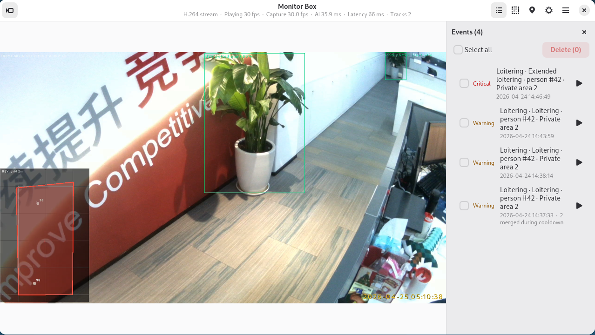

# 📹 监控盒子 - AI 视频监控

简体中文 | [English](README.md)

监控盒子是基于 **[Quectel Pi M2](https://developer.quectel.com/)** 智能主控板（Rockchip **RK3576**，Debian 13）的 AI 视频监控示例。设备通过 USB UVC 摄像头采集实时画面，在 6 TOPS 板载 NPU 上运行目标检测、姿态检测和火焰烟雾检测模型，再由规则引擎输出可配置的监控告警。

项目包含 C++17 采集/推理后端，以及 Python + GTK4/Libadwaita 桌面 APP。后端同时提供浏览器控制台、MJPEG 预览、H.264 推流、事件快照、告警录像和本地 HTTP 接口。



核心功能：

- 实时检测人员、车辆、宠物及其他 COCO 常见目标
- 入侵、电子围栏、人员滞留和遗留包裹告警
- 按有向进出线统计进入和离开人数
- 基于人体姿态的跌倒检测
- 带时序确认的火焰和烟雾检测
- 地面二维定位、轨迹、地面区域和鸟瞰图
- 桌面 APP 与 Web 控制台共用一份持久配置
- 告警快照、录像、声音提示和低功耗模式

> **状态：** RK3576 上的采集 → 检测 → 跟踪 → 规则 → OSD → 事件/推流链路已实现。运行时要求 RKNN **2.3.2**。默认 YOLOv8s 检测模型在 NPU 上约 **29.6 ms/帧**；姿态和火焰烟雾模型为可选依赖。实际部署仍需根据机位和现场画面调整告警阈值。

## 🎯 功能特点

- **NPU 加速检测**：默认使用 YOLOv8s INT8，可切换为功耗更低的 YOLOv8n。
- **共享跟踪与规则引擎**：所有空间功能共用一次跟踪结果；关闭的功能不会被实例化，也不消耗 CPU。
- **灵活的告警区域**：可直接在实时画面上绘制自家、公共、忽略和地面标定区域。
- **双向人数统计**：通过有向进出线分别累计 `IN` / `OUT`，并按小时写入 JSONL 历史。
- **姿态跌倒检测**：RTMPose 只对检测到的人员区域推理，姿态帧率和判定阈值均可配置。
- **火焰烟雾检测**：独立运行 D-Fire 模型，通过持续时间和投票抑制单帧误报。
- **地面二维定位**：完成地面标定后把脚点换算为米制坐标，平滑轨迹并显示鸟瞰图。
- **完整事件链路**：支持去抖、冷却、告警分级、快照、事件前后录像、容量回收和声音提示。
- **本地与远程操作**：既可通过 GTK4 桌面 APP 操作，也可在局域网浏览器中使用 Web 控制台。

## 🖥️ 界面说明

桌面 APP 以一路实时画面为中心，提供三个常用工具入口：

1. **实时画面**：显示后端视频、检测框、启用中的区域、进出线和性能指标。
2. **事件**：查看告警级别、快照、录像，并支持单条或批量删除。
3. **区域设置**：绘制告警区域、进出线、忽略区和地面标定。
4. **设置**：配置检测功能、事件声音、视频与推理参数、地面定位和功耗模式。

内置 Web 控制台通过 `http://<板子IP>:8080` 提供相同的配置和事件数据。桌面 APP 与 Web 控制台共用 `config/monitor_box.json`，任一界面保存后，另一界面都能看到最新配置。

## ⚙️ 工作原理

1. **采集**：V4L2 读取 UVC 视频流，默认是 1920×1080、30 fps 的 MJPG 画面。
2. **预处理**：解码并 letterbox 缩放画面，准备对应的 NPU 模型输入。
3. **推理**：RKNN 按各自节拍运行目标检测、人体姿态和/或火焰烟雾模型。
4. **跟踪与分析**：ByteTrack 风格的跟踪器稳定目标 ID，空间规则再判断区域、越线、停留时间和地面坐标。
5. **输出**：后端绘制 OSD，并输出 MJPEG、H.264/RTP、事件快照和告警录像。

```text
USB UVC 摄像头
      │
      ▼
V4L2 采集 ──► 预处理 ──► RKNN 检测 / 姿态 / 火焰烟雾
      │                               │
      │                               ▼
      └────────────► 跟踪器 ──► 规则与事件引擎
                                      │
             ┌────────────────────────┼────────────────────────┐
             ▼                        ▼                        ▼
      OSD + MJPEG/H.264        快照 + 告警录像         桌面 APP / Web
```

## 📋 系统要求

### 硬件要求

- Quectel Pi M2 智能主控板（RK3576）
- USB UVC 摄像头，建议支持 1080p MJPG
- 网络连接，用于访问 Web 控制台
- 显示器、键盘和鼠标，用于本地桌面 APP（可选）
- 有源音箱或 USB 音频设备，用于告警声音（可选）

### 软件要求

- Debian 13（Quectel Pi M2 默认系统）
- RKNN 运行时 `librknnrt.so` **2.3.2**
- SDK 交叉工具链，或板上 `g++`（原地编译）
- Python 3，以及 GTK4、Libadwaita 和 GStreamer 桌面运行库
- 板上 RKNN、RGA、MPP 和 JPEG 运行库

RKNN 头文件、板上运行时和模型转换工具必须统一使用 **2.3.2**。版本不一致时，程序通常会在模型加载阶段由 `rknn_init` 直接报错。

| 组件 | 要求版本 |
| --- | --- |
| 板上 `librknnrt.so` | 2.3.2 |
| 编译使用的 `rknn_api.h` | 2.3.2 |
| 转换模型使用的 `rknn-toolkit2` | 2.3.2 |

> 本项目不支持 MIPI OV5693 路线：出厂内核未启用对应 sensor 驱动，设备树中没有匹配节点，也没有 IQ 标定文件。

## 🚀 编译、部署与运行

### 1. 在 SDK 中编译

在 SDK 宿主机执行：

```bash
git clone https://github.com/Quectel-Pi/QPi-SDK.git
cd QPi-SDK
git clone https://github.com/Quectel-Pi/demo-monitor-box.git projects/demo-monitor-box
make -C projects/demo-monitor-box
```

主要产物：

```text
projects/demo-monitor-box/build/mb-infer
projects/demo-monitor-box/build/mb-capture
```

`mb-capture` 是实时监控后端；`mb-infer` 是离线单图推理工具，用于验证模型和 NPU 通路。

运行宿主机回归测试：

```bash
make -C projects/demo-monitor-box test
```

### 2. 部署到开发板

确认开发板已通过 ADB 连接，并检查 shell 权限：

```bash
adb devices
adb shell id
```

在 SDK 根目录推送运行所需文件：

```bash
adb shell 'mkdir -p /userdata/monitor_box/deploy/build /userdata/monitor_box/deploy/config /userdata/monitor_box/deploy/models /userdata/monitor_box/deploy/tools /userdata/monitor_box/deploy/app'

adb push projects/demo-monitor-box/build/mb-infer projects/demo-monitor-box/build/mb-capture /userdata/monitor_box/deploy/build/
adb push projects/demo-monitor-box/config/monitor_box.json /userdata/monitor_box/deploy/config/
adb push projects/demo-monitor-box/models/yolov8s-640-640.rknn projects/demo-monitor-box/models/coco_80_labels_list.txt /userdata/monitor_box/deploy/models/
adb push projects/demo-monitor-box/install.sh projects/demo-monitor-box/setup_autostart.sh /userdata/monitor_box/deploy/
adb push projects/demo-monitor-box/app/99-monitor-box-video.conf /userdata/monitor_box/deploy/app/
adb push projects/demo-monitor-box/tools/migrate_config.py /userdata/monitor_box/deploy/tools/
```

安装后端，并保留已有持久配置：

```bash
adb shell 'cd /userdata/monitor_box/deploy && bash install.sh'
```

安装成功时终端会显示 `Deployment complete.`。程序安装到 `/opt/monitor_box`；已有配置会先备份，再按需迁移，用户开关、区域和阈值不会被默认配置覆盖。

### 3. 安装桌面 APP

在 SDK 根目录执行，开发板需保持 ADB 连接：

```bash
bash projects/demo-monitor-box/app/install_app.sh
```

安装完成后，在 GNOME 应用列表搜索 **监控盒子** / **Monitor Box**，或手动启动：

```bash
/opt/monitor_box/app/monitor-box-app
```

### 4. 配置开机自启（推荐）

在开发板上进入部署目录：

```bash
cd /userdata/monitor_box/deploy
bash setup_autostart.sh install
```

后端随后作为系统级 `monitor-box` 服务运行：

```bash
sudo systemctl status monitor-box --no-pager
sudo systemctl restart monitor-box
sudo systemctl stop monitor-box
journalctl -u monitor-box -f
```

只移除自启动服务、不删除程序和配置：

```bash
bash setup_autostart.sh uninstall
```

### 5. 打开 Web 控制台

先在开发板上检查后端状态：

```bash
curl --fail http://127.0.0.1:8080/status
```

然后在同一局域网的浏览器中访问：

```text
http://<板子IP>:8080
```

摄像头正常运行时，`/status` 应报告 `camera.connected: true` 和 `h264.running: true`。视频链路稳定后，`capture_fps` 应接近配置帧率。

### 可选姿态与火焰烟雾模型

项目已包含默认 YOLOv8s、低功耗 YOLOv8n 检测模型和 COCO 标签。

跌倒检测还需要 RTMPose 模型。请在 SDK 根目录执行：

```bash
cd <SDK 根目录>
PYTHON=<rknn-2.3.2-python> projects/demo-monitor-box/tools/get_rtmpose.sh t
adb push projects/demo-monitor-box/models/rtmpose_t-256x192-rk3576.rknn /opt/monitor_box/models/
```

火焰烟雾检测需要先生成对应模型。请在 SDK 根目录执行：

```bash
projects/demo-monitor-box/tools/fire_model/build_fire_model.sh
adb push projects/demo-monitor-box/models/fire_yolov8n.rknn projects/demo-monitor-box/models/fire_labels.txt /opt/monitor_box/models/
```

模型转换、精度评估和许可说明见 [tools/fire_model/README.md](tools/fire_model/README.md)。

## 🎛️ 使用说明

### 首次配置

1. 将 UVC 摄像头接入 USB 3.0 接口，确认 Linux 已识别设备。
2. 启动后端服务，然后打开桌面 APP 或 Web 控制台。
3. `mb-capture` 运行期间，APP 视频来源保持 **自动**。
4. 打开 **区域设置**，按安装位置绘制区域和进出线。
5. 在 **设置** 中启用需要的检测功能。
6. 使用地面定位时，先绘制地面标定区并填写实际尺寸。
7. 用现场画面和典型目标验证功能，再调整告警阈值。

启动前可检查摄像头节点：

```bash
v4l2-ctl --list-devices
ls -l /dev/video*
```

默认配置使用 `/dev/video73`。如果开发板分配了其他节点，请修改 `video.device`，或手工启动后端时传入 `--device <节点>`。

### 功能配置

| 能力 | 默认状态 | 额外配置 |
| --- | --- | --- |
| 物体检测 | 开启 | 无需配置，YOLOv8s 模型随项目提供 |
| 入侵检测 | 关闭 | 启用后绑定自家区域 |
| 电子围栏 | 关闭 | 启用后绘制围栏区域 |
| 人数统计 | 关闭 | 绘制有向进出线并绑定功能 |
| 人员滞留 | 关闭 | 绑定区域并设置 `dwell_sec` |
| 包裹检测 | 关闭 | 检测背包、手提包或行李箱，调整 `static_sec` |
| 跌倒检测 | 关闭 | 安装姿态模型并启用 `features.fall` |
| 火焰烟雾 | 关闭 | 生成火焰模型并启用 `features.fire` |
| 地面定位 | 开启 | 完成有效的地面标定 |

**物体检测** 开关只控制绘制哪些目标类别。入侵、统计、滞留、跌倒和定位等功能仍会按需运行 YOLO，因此关闭“物体检测”并不等于停止检测模型。

### 日常运行

```bash
sudo systemctl start monitor-box
sudo systemctl restart monitor-box
sudo systemctl status monitor-box --no-pager
```

只有首次安装或更新程序时才需要重新部署。功能开关、区域、阈值以及大多数规则参数保存成功后约 1 秒内热加载；摄像头、模型路径、Web 和推流参数需要重启后端。

手工运行后端时，先停止服务，避免摄像头和端口冲突：

```bash
sudo systemctl stop monitor-box
sudo /opt/monitor_box/bin/mb-capture --config /opt/monitor_box/etc/monitor_box/monitor_box.json
```

后端日志位于 `/opt/monitor_box/log/service.log` 和 `service_error.log`。

### 功耗模式

| 模式 | 行为 |
| --- | --- |
| `normal` | 正常采集、推理和告警 |
| `eco` | 降低采集和推理帧率 |
| `standby` | 释放摄像头，Web 和状态接口继续可用 |

默认情况下，关闭桌面 APP 不会停止后端。不需要监控时，可通过 APP 摄像头按钮或 `power.mode` 进入待机。开启 `power.follow_app` 后，后端可跟随 APP 的摄像头开关状态。

## 📊 性能参考

以下数据在 Quectel Pi M2 / RK3576 上实测：

| 模型 | NPU 耗时 | 说明 |
| --- | --- | --- |
| YOLOv8s 640×640 | 约 29.6 ms/帧 | 默认检测模型 |
| YOLOv8n 640×640 | 约 15.6 ms/帧 | 低功耗备选 |
| RTMPose-t | 约 8 ms/人 | 只对检测到的人员区域运行 |
| 火焰 YOLOv8n | 约 14.1 ms/帧 | 可选模型，按独立节拍运行 |

实时链路将采集和推理解耦。推理变慢时只会降低推理频率，不会阻塞视频输出。默认检测帧率为 12 fps，姿态和火焰烟雾模型分别使用自己的配置帧率。

## 📁 项目结构

```text
demo-monitor-box/
├── README.md                       # 英文说明
├── README.zh-CN.md                 # 简体中文说明
├── CMakeLists.txt                  # CMake 构建
├── Makefile                        # 编译、测试、安装和镜像入口
├── install.sh                      # 板上后端部署
├── setup_autostart.sh              # systemd 服务安装
├── app/                            # GTK4 桌面 APP
├── config/monitor_box.json         # 默认持久配置
├── docs/
│   ├── monitor_demo.md             # 完整 Demo 与 Web 使用说明
│   └── assets/                     # 文档图片
├── examples/                       # mb-infer、mb-capture 和测试程序
├── models/                         # 检测模型和标签
├── src/
│   ├── infer/                      # RKNN、预处理、YOLO 和姿态
│   ├── video/                      # V4L2、OSD 和 H.264 编码
│   ├── stream/                     # RTP、MP4 录像和视频流水线
│   ├── track/                      # 多目标跟踪器
│   ├── rules/                      # 空间规则、跌倒和火焰逻辑
│   ├── locate/                     # 地面标定与二维定位
│   ├── event/                      # 告警路由、录像和声音
│   └── web/                        # HTTP 接口与内嵌 Web 控制台
├── third_party/                    # 第三方源码和许可证
└── tools/                          # 模型、构建和部署工具
```

## 🛠️ 配置参数

持久配置文件位于：

```text
/opt/monitor_box/etc/monitor_box/monitor_box.json
```

项目默认配置为 [config/monitor_box.json](config/monitor_box.json)。常用参数如下：

| 参数 | 默认值 | 说明 |
| --- | --- | --- |
| `video.device` | `/dev/video73` | V4L2 摄像头节点 |
| `video.width` / `video.height` | `1920` / `1080` | 采集分辨率 |
| `video.fps` | `30` | 摄像头采集帧率 |
| `infer.infer_fps` | `12` | 检测推理帧率 |
| `infer.conf_threshold` | `0.25` | 检测置信度阈值 |
| `features.object.enabled` | `true` | 绘制启用类别 |
| `features.intrusion.enabled` | `false` | 入侵检测 |
| `features.count.enabled` | `false` | 双向人数统计 |
| `features.fall.enabled` | `false` | 姿态跌倒检测 |
| `features.fire.enabled` | `false` | 火焰烟雾检测 |
| `features.locate.enabled` | `true` | 地面二维定位 |
| `models.pose.path` | `/opt/monitor_box/models/rtmpose_t-256x192-rk3576.rknn` | 可选姿态模型 |
| `models.fire.path` | `/opt/monitor_box/models/fire_yolov8n.rknn` | 可选火焰模型 |
| `web.listen` / `web.port` | `0.0.0.0` / `8080` | Web 控制台监听地址和端口 |
| `power.mode` | `normal` | `normal`、`eco` 或 `standby` |
| `events.clip_pre_sec` / `clip_post_sec` | `5` / `5` | 告警发生前后的录像秒数 |

建议通过桌面 APP 或 Web 控制台保存配置。后端会校验完整配置，原子写入文件，并热加载支持的改动。

> Web 接口没有身份认证，且可以修改配置。只建议在可信局域网使用，或把 `web.listen` 改为 `127.0.0.1`。

## 🧪 常见问题

- **未识别摄像头**：运行 `v4l2-ctl --list-devices`；重新插拔后节点可能变化，请同步修改 `video.device`。
- **设备被占用**：启动第二个 `mb-capture` 或 APP 直连摄像头前，先停止 `monitor-box` 服务。
- **模型加载失败**：确认 RKNN 文件、板上 `librknnrt.so` 和转换工具均为 2.3.2。
- **开启功能后没有告警**：确认该功能至少绑定了一个区域或进出线。
- **定位跳动或误差较大**：保证地面区域清晰可见，重新选择标定角点；移动摄像头后需重新标定。
- **APP 没有画面**：后端服务运行时，APP 视频来源保持 **自动**。
- **浏览器无法访问**：先在板上执行 `curl http://127.0.0.1:8080/status`，再检查网络和防火墙设置。

## 📄 补充文档

- [完整 Demo 与 Web 使用说明](docs/monitor_demo.md)

## 报告问题

如在使用过程中遇到问题，欢迎在 [移远官方论坛](https://forumschinese.quectel.com/c/quectel-pi/58) 提交技术咨询。也欢迎提交 Issue 和 Pull Request 来改进此项目。
